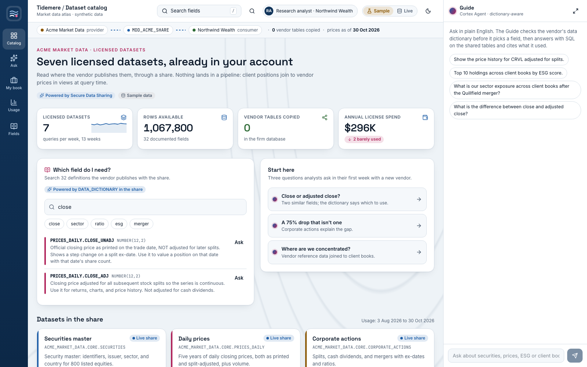

# Market Data Discovery Agent

Help research and data teams find, understand, and query licensed market and reference data in plain English, in place, without copying it into pipelines.

A Snowflake example on synthetic data, presented as **Tidemere**, a fictional "market data atlas" app. **[See the guide](https://sfc-gh-ooral.github.io/sfguide-market-data-discovery/)** · **[Try it in your browser](https://sfc-gh-ooral.github.io/sfguide-market-data-discovery/try/)** (no account needed)



Firms license market, reference, and fundamentals data from vendors. Moving it through files and ETL is slow and costly. Even once it has landed, analysts struggle to find the right field ("Which table has the issuer's sector? Close or adjusted close?") without a data engineer. This example reads a fictional vendor's datasets where they're published, and gives three people what they need:

- **Research analysts** browse a catalog, search the vendor's data dictionary from anywhere (`/` or ⌘K), and ask the **Guide**, an agent docked beside every screen, in plain English. Every answer comes with a chart, the SQL, result rows, and the dictionary entries it relied on.
- **Data engineers** skip the pipeline. Firm views and a semantic view read the vendor tables in place, and client holdings join to vendor prices at query time.
- **Market data managers** see queries, users, and last access for each licensed dataset next to its cost, then record keep-or-review decisions for renewal.

> **Synthetic data, illustrative logic.** "Acme Market Data," "Northwind Wealth," and every issuer, ticker, fund, advisor, and client are fictional. This is not investment, regulatory, or compliance advice, and it isn't a production system.

## What's in the app

| Screen | What it shows | Snowflake capability (live mode) |
| --- | --- | --- |
| **Catalog** | KPI tiles, seven dataset cards with row counts, freshness, a "Live share" badge and a 13-week usage sparkline, plus a dictionary search. Each dataset page has sortable field definitions, sample rows, the SQL to read it in place, and (for prices) a split explainer chart of adjusted vs. printed close. | Provider tables published to a share (Secure Data Sharing), read in place |
| **Guide / Ask the data** | An agent, docked on every screen and with a full view, that checks the dictionary, writes SQL, and answers with a chart, the SQL, result rows and numbered citations, shown with staged progress steps and a streaming reveal. Asked for split-adjusted history, it picks `CLOSE_ADJ` over `CLOSE_UNADJ` because the dictionary says to. | Cortex Agents, Cortex Search (dictionary), Cortex Analyst (semantic view `MARKET_DATA_SV`) |
| **Join to my book** | Client holdings joined to vendor securities and prices: sector and country exposure before and after a merger, top names, exposure by advisor, and a sortable, filterable review queue of accounts above a 10% single-name guideline. Each account opens a drawer showing its pre-merger weights in the acquirer and the target, and can be sent to the advisor for review (kept in the browser session). | A firm view over the vendor tables (no copy) |
| **Usage & value** | KPI tiles, a weekly stacked usage chart, upcoming renewals, and a license review table. Each dataset opens a drawer to record keep / review / cancel with a note, saved to a table in Live mode. | `ACCOUNT_USAGE.ACCESS_HISTORY` (live column), plus a synthetic 90-day usage log |

On this synthetic data set, the walkthrough shows four planted findings (details in [`data/README.md`](data/README.md)):

1. A 4-for-1 split makes the unadjusted close drop 75% overnight. The adjusted close is continuous, and `CORPORATE_ACTIONS` explains the gap.
2. Asked for price history, the agent uses `CLOSE_ADJ` and cites the dictionary entry that says so.
3. After Quillfield Semiconductor merges into Arvane Systems, Technology goes from 24.8% to 27.6% of client value. Accounts above a 10% guideline in ARVN go from 53 to 171.
4. Two of seven licensed datasets, ESG scores and fund holdings, had three queries or fewer in 90 days.

## Prerequisites

**No-account mode:** Node.js 20.19 or later. Nothing else.

**Live mode:**

- A Snowflake account, **Enterprise Edition or higher** for `ACCOUNT_USAGE.ACCESS_HISTORY`. On Standard Edition, everything else works and the Usage screen says the live column is unavailable.
- Cortex AI available in your region, or [cross-region inference](https://docs.snowflake.com/en/user-guide/snowflake-cortex/cross-region-inference) enabled. The agent uses `orchestration: auto`.
- `ACCOUNTADMIN` to run `sql/setup.sql`. It creates two roles, a warehouse, two databases, a share, and an API integration. The app then runs as the least-privilege role `MDD_ANALYST_ROLE`.
- Key-pair authentication for your Snowflake user (steps below).

Tested in November 2026 on AWS US East (N. Virginia), Enterprise Edition, with Node.js 22 and `snowflake-sdk` 3.4.

## Quick start (no account)

```bash
git clone https://github.com/sfc-gh-ooral/sfguide-market-data-discovery.git
cd sfguide-market-data-discovery
npm install
npm run dev
```

Open <http://localhost:3000>. The header switch shows **Sample**: the bundled synthetic data in `lib/mock/market.json`. Agent answers are scripted and labeled **Sample AI response**. They wait a few seconds and show the same steps the live agent takes. Sample mode answers four built-in questions (shown as buttons). Live mode answers anything.

## Live mode: deploy to your account

1. **Run setup.** Open `sql/setup.sql` in a Snowsight SQL worksheet and **Run All** as ACCOUNTADMIN. It loads the synthetic CSVs from this public repository through a Git repository clone. Nothing needs editing.
2. **Create a key pair** and register it on your user:
   ```bash
   mkdir -p ~/.snowflake/keys
   openssl genrsa 2048 | openssl pkcs8 -topk8 -inform PEM -out ~/.snowflake/keys/mdd_rsa_key.p8 -nocrypt
   openssl rsa -in ~/.snowflake/keys/mdd_rsa_key.p8 -pubout
   ```
   ```sql
   ALTER USER <YOUR_USER> SET RSA_PUBLIC_KEY_2 = '<public key body, without the BEGIN/END lines>';
   ```
3. **Configure the app.** Copy `.env.example` to `.env.local` (git-ignored) and set `SNOWFLAKE_ACCOUNT` (`<orgname>-<account_name>`), `SNOWFLAKE_USERNAME`, and `SNOWFLAKE_PRIVATE_KEY_PATH`.
4. **Run it.** `npm run dev`. The header switches to **Live**, and every screen shows the role and measured latency. You can switch back to Sample at any time. If a live call fails, the screen shows the error; it never falls back to sample data.
5. **Clean up.** Run `sql/cleanup.sql` as ACCOUNTADMIN. It drops everything below and ends with `SHOW` commands that should all return no rows.

The app never asks for credentials in the browser.

### Objects created

| Object | Name | Notes |
| --- | --- | --- |
| Roles | `MDD_DEMO_ROLE`, `MDD_ANALYST_ROLE` | Owner role; least-privilege app role, granted to the user who runs setup |
| Warehouse | `MDD_WH` | XSMALL, `AUTO_SUSPEND = 60`, initially suspended |
| Database | `ACME_MARKET_DATA` (schema `CORE`) | The vendor's provider database: 7 tables |
| Share | `MDD_ACME_SHARE` | All `CORE` tables. No consumer accounts are added |
| Database | `MARKET_DATA_DISCOVERY` (schemas `FIRM`, `APP`) | Client books, licenses, usage log, views `POSITIONS_VALUED`, `LATEST_ESG`, `LIVE_DATASET_ACCESS`, semantic view `MARKET_DATA_SV`, Cortex Search service `DICTIONARY_SEARCH`, agent `MARKET_DATA_AGENT`, Git repository `MDD_REPO`, stage `MDD_DATA`, table `APP.LICENSE_REVIEW_DECISIONS` |
| Integration | `MDD_GIT_API` | Read-only access to `https://github.com/sfc-gh-ooral/`, no credentials |

Setup changes nothing that already exists.

### Least privilege

`MDD_DEMO_ROLE` owns the databases and warehouse. It reads `ACCESS_HISTORY` through `SNOWFLAKE.GOVERNANCE_VIEWER` only to build `LIVE_DATASET_ACCESS`, which is limited to the vendor tables. The app's `MDD_ANALYST_ROLE` gets:

- On the vendor tables, exactly what `MDD_ACME_SHARE` carries: `USAGE` on the database and schema, and `SELECT` on the tables.
- `SELECT` on the firm tables and views, the semantic view, and `LIVE_DATASET_ACCESS`. No account-wide `ACCOUNT_USAGE`.
- `USAGE` on the search service and agent, and `SELECT, INSERT` on the review decisions table.
- `SNOWFLAKE.CORTEX_USER` and `USAGE` on `MDD_WH`.

The app connects with `USE SECONDARY ROLES NONE`, so those grants are the whole story.

### About the share

Snowflake doesn't let an account mount its own share ("self-sharing"). So this example plays both sides in one account. It creates the vendor's provider database and a real share, and the firm-side role gets the same grants the share carries and reads the provider tables directly. Either way, no vendor data is copied into the firm database: the Catalog shows **Vendor tables copied: 0**, counted from the firm database's `INFORMATION_SCHEMA` in live mode.

To see it from the consumer side, add a second account (`ALTER SHARE MDD_ACME_SHARE ADD ACCOUNTS = <org>.<account>;`) and create a database from the share there. In production you'd mount the vendor's share or a [Snowflake Marketplace](https://docs.snowflake.com/en/user-guide/data-marketplace) listing. Then point the firm views, the semantic view, and the search service at the mounted database name instead of `ACME_MARKET_DATA`. A mounted share is read-only, so `CHANGE_TRACKING` for Cortex Search is the provider's choice.

## Expected cost and time

Measured in our test account (XSMALL warehouse, November 2026, v2 rebuild):

| Step | Time | Compute |
| --- | --- | --- |
| `sql/setup.sql` | About 85 seconds from a clean account | Included below |
| Setup plus a full live walkthrough of every screen | – | **0.233 warehouse credits** on `MDD_WH` (`WAREHOUSE_METERING_HISTORY`) |
| Agent questions | 16 to 31 seconds each | About **0.18 AI credits per question** (0.885 for 5 questions, from `CORTEX_AGENT_USAGE_HISTORY`) |
| Usage screen's live column | About 50 seconds the first time (it reads `ACCESS_HISTORY`) | Included above |
| Cortex Search service | – | Rounded to 0.00 credits for the day in `CORTEX_SEARCH_DAILY_USAGE_HISTORY` in the v1 run (32 short documents) |

Agent cost depends on the model chosen by `orchestration: auto` and on the question. The search service keeps a small serving cost while it exists, so run `sql/cleanup.sql` when you're done.

## Known limitations

- One account plays both vendor and firm (see [About the share](#about-the-share)). Cross-account sharing and Marketplace listings aren't exercised here.
- Daily prices come from a formula, not real markets. Splits, the merger, and the usage gaps are planted to tell the story.
- `ACCESS_HISTORY` can lag by up to about 3 hours, and a new account has no 90-day history. The usage history is a synthetic log, and live mode adds a column with your account's real query counts.
- Agent answers can vary between runs. The app shows the SQL and sources for every answer so you can check them. Charts are drawn from the agent's result table: one measure for bar charts, up to two price series for line charts.
- The **Send to advisor for review** action on the Book screen is kept in the browser session only; license decisions on the Usage screen are the ones saved to Snowflake.
- The Usage screen's live column counts every query on the vendor tables in the account in the last 90 days, including earlier runs of this example.
- Sample mode has four scripted questions. Other questions get the closest scripted answer, with a note saying so.
- The 10% single-name guideline is illustrative, not a rule or recommendation.

## Customize with Cortex Code

Open this repository in [Cortex Code](https://docs.snowflake.com/en/user-guide/cortex-code/cortex-code) and try:

- "I mounted a Marketplace listing as database `<DB>`. Profile it, draft a semantic view, and write verified queries for my top five research questions. Don't change any objects until I approve the plan."
- "Join this listing to my holdings table `<DB.SCHEMA.TABLE>` and build an exposure view by sector and country. Don't copy the shared data, and propose least-privilege grants first."
- "Report which licensed datasets in `<DB>` have had no queries in the last 90 days, using `ACCESS_HISTORY`, and add the result to the Usage screen."

## Project layout

```text
app/                     Next.js App Router pages (catalog, dataset, ask, book, usage) and API routes
components/              Tidemere shell (rail, share strip, dictionary palette), Guide agent panel, charts, tables, drawers
lib/market-data.ts       The data interface every screen uses
lib/mock-data.ts         No-account implementation and scripted sample answers
lib/live-data.ts         Live implementation (bind variables only) and agent response parsing
scripts/                 generate-data.mjs, build-hosted-example.mjs, capture-screenshots.mjs, check-contrast.mjs
sql/                     setup.sql and cleanup.sql
data/                    Synthetic CSVs and data/README.md (planted stories)
docs/                    GitHub Pages guide, DESIGN.md (brand and design system), fonts, screenshots, and the hosted example in docs/try/
```

`npm run build:example` rebuilds the hosted example in `docs/try/`. `npm run capture` refreshes the screenshots from it.

## License and disclaimer

Licensed under the [Apache License 2.0](LICENSE).

This is an illustrative example provided as-is. It isn't an official Snowflake product and isn't supported by Snowflake Support. It contains no customer data. Review and test before any production use. See [LEGAL.md](LEGAL.md).

Owner: Oz Oral · Last reviewed: November 2026
